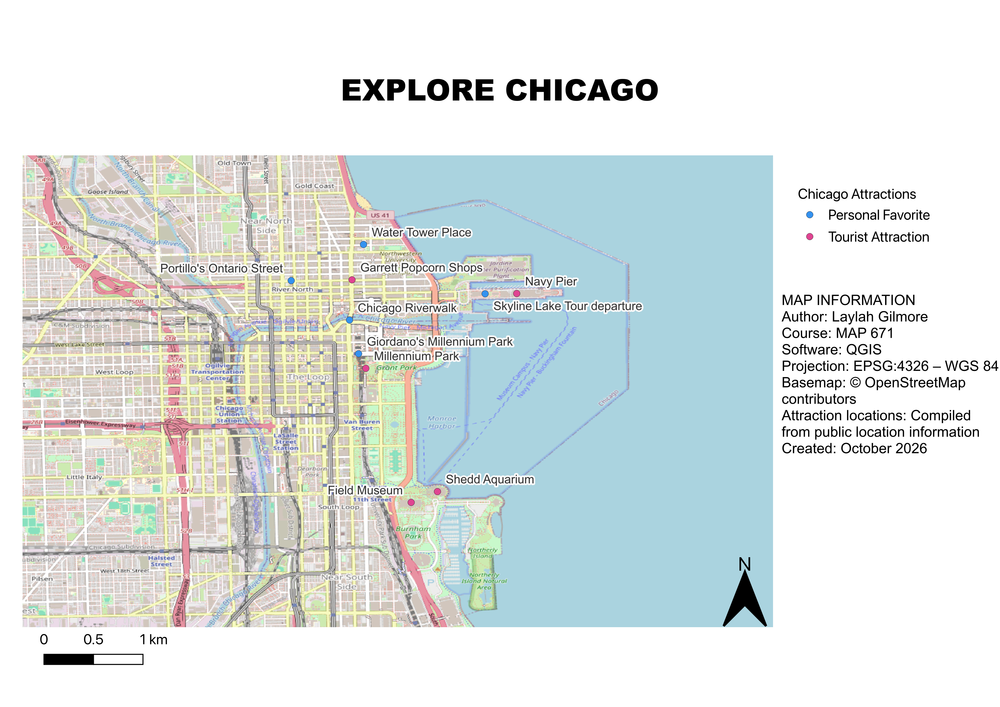

# Explore Chicago: Tourist Attractions & Personal Favorites

**Author:** Laylah Gilmore  
**Course:** MAP 671  
**Created:** October 2026

## Project Overview

This project presents a map of ten locations throughout downtown Chicago, Illinois. The map highlights popular tourist attractions alongside personal favorite destinations, providing visitors with a combination of well-known landmarks and other places to explore.

## Project Contents

- [Data Sources](#data-sources)
- [Project Background](#project-background)
- [Purpose](#purpose)
- [Mapmaking Process](#mapmaking-process)
- [Map Summary](#map-summary)
- [Final Project Website](#final-project-website)

## Data Sources

- **Basemap:** OpenStreetMap contributors
- **Attraction locations:** Compiled from publicly available location information
- **Location data:** `chicago_attractions_qgis.csv`
- **Coordinate Reference System:** EPSG:4326 (WGS 84)
- **Mapping Software:** QGIS

## Project Background

Chicago is home to numerous cultural attractions, historic landmarks, parks, restaurants, and waterfront destinations. This project focuses on the downtown area and nearby lakefront, where many popular destinations are concentrated.

The map features locations such as Navy Pier, Millennium Park, the Field Museum, Shedd Aquarium, and other attractions.

## Purpose

The purpose of this map is to show visitors fun and popular things to do in Chicago while also introducing personal favorites and potentially more affordable alternatives. By displaying these locations together, the map helps visitors identify different places to explore and plan their activities.

## Mapmaking Process

1. Compiled ten Chicago locations and organized their geographic information in a CSV file.
2. Imported the location data into QGIS and displayed the points on an OpenStreetMap basemap.
3. Categorized the locations as tourist attractions or personal favorites.
4. Applied different colored symbols to distinguish the two categories.
5. Added labels identifying each destination.
6. Designed a final print layout with a title, legend, scale bar, north arrow, and map information.
7. Exported the completed map as a PNG image.
8. Created an HTML webpage displaying the map, project description, and supporting information.
9. Published the project using GitHub Pages.

### Final Map

## Map Summary

The final map illustrates the distribution of ten destinations in downtown Chicago and along the Lake Michigan waterfront. The two categories help distinguish widely recognized tourist attractions from personal favorites.

This project demonstrates how QGIS can be used to organize geographic data, create thematic symbols, and communicate location-based information through a map. Publishing the map online also makes the project accessible to visitors and other viewers.

## Final Project Website

[View the completed Chicago Tourist Attractions website](https://lg-m07.github.io/LaylahGilmore-map671-f26-tourist-attractions-chicago/)

## Project Files

- `Chicago_Tourist_Map.png` — Exported final map
- `Chicago_Tourist_Map.qgz` — QGIS project
- `chicago_attractions_qgis.csv` — Attraction location data
- `index.html` — Published project webpage

**Map data attribution:** © OpenStreetMap contributors.
